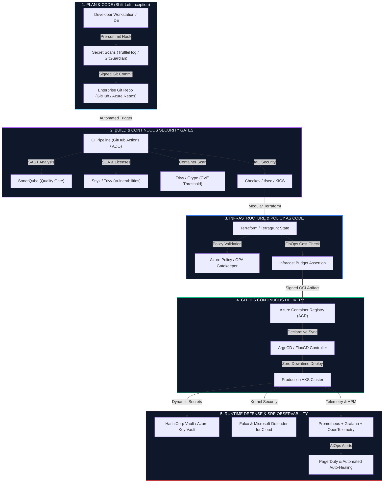

<p align="center">
  
</p>

<p align="center">
  <a href="https://linkedin.com/in/gaurav-vishwamitra" target="_blank">
    
  </a>
  <a href="mailto:dreamplantgaurav@gmail.com">
    
  </a>
  <a href="#-flagship-enterprise-architectures">
    
  </a>
  <a href="https://github.com/dreamplantgaurav-alt">
    
  </a>
</p>

<p align="center">
  
</p>

---

## ⚡ Executive Summary

I am a **Senior DevSecOps Engineer & Cloud Solutions Architect** with **5+ years of battle-tested enterprise experience** spearheading mission-critical cloud migrations, architecting Zero-Trust cloud environments, and driving large-scale automation on **Microsoft Azure** and **Kubernetes**.

I operate at the intersection of **Strategic Business Vision** and **Hardcore Systems Engineering** — translating executive mandates (reliability, velocity, regulatory compliance, FinOps ROI) into immutable Infrastructure-as-Code (IaC), bulletproof CI/CD pipelines, and self-healing distributed platforms.

> *"Security is not a final checkpoint or an afterthought; it is an immutable, automated guardrail woven into every line of code, every container image, and every cloud resource from inception."*

---

### 📊 Enterprise Impact At A Glance

```
┌───────────────────────────────┬───────────────────────────────┬───────────────────────────────┐
│     100+ Enterprise Apps      │         99.99% Uptime         │         35% Cost Cut          │
│   Migrated & Modernized on    │  Engineered Multi-Region HA   │  FinOps Rightsizing & Cloud   │
│     Azure Zero-Downtime       │   & Disaster Recovery (RPO=0) │     Governance Automation     │
├───────────────────────────────┼───────────────────────────────┼───────────────────────────────┤
│         < 15 Minutes          │           100% Shift          │           Zero Leaks          │
│   Commit-to-Production Lead   │   Pre-Commit to Runtime SAST, │   Automated Secrets Mgmt with │
│     Time with GitOps Gates    │     SCA & Policy-as-Code      │   HashiCorp Vault & Azure KV  │
└───────────────────────────────┴───────────────────────────────┴───────────────────────────────┘
```

---

## 🏛️ End-to-End Enterprise DevSecOps Blueprint

Below is the **Production-Grade Reference Architecture** implemented across multi-tier enterprise environments, adhering strictly to **Zero-Trust (NIST SP 800-207)** and **Shift-Left Security** standards:



---

## 🛠️ Technical Competency & Tooling Radar

<table>
  <thead>
    <tr>
      <th width="26%">Pillar</th>
      <th width="44%">Technology Stack & Tools</th>
      <th width="30%">Core Architectural Competency</th>
    </tr>
  </thead>
  <tbody>
    <tr>
      <td><b>Cloud Platforms & Architecture</b></td>
      <td>
        
        
        
      </td>
      <td>Hub-and-Spoke Topology, Azure CAF, ExpressRoute, Landing Zones, Multi-Region Active/Passive DR, Private Endpoints</td>
    </tr>
    <tr>
      <td><b>Infrastructure as Code (IaC)</b></td>
      <td>
        
        
        
        
      </td>
      <td>Modular IaC architecture, State locking & encryption, Continuous drift detection, Infracost automation</td>
    </tr>
    <tr>
      <td><b>Containers & Orchestration</b></td>
      <td>
        
        
        
        
      </td>
      <td>Hardened cluster provisioning, Calico Network Policies, KEDA event-driven autoscaling, Istio mTLS, Ingress NGINX</td>
    </tr>
    <tr>
      <td><b>CI/CD & GitOps Automation</b></td>
      <td>
        
        
        
        
      </td>
      <td>Declarative GitOps sync, Canary & Blue/Green automated cutovers, Ephemeral self-hosted runners</td>
    </tr>
    <tr>
      <td><b>DevSecOps & Shift-Left</b></td>
      <td>
        
        
        
        
        
      </td>
      <td>SAST/DAST/SCA automation, Policy-as-Code (OPA/Kyverno), Dynamic secrets leasing, CIS Benchmarks, CycloneDX SBOM</td>
    </tr>
    <tr>
      <td><b>Observability, APM & SRE</b></td>
      <td>
        
        
        
        
      </td>
      <td>Distributed tracing (OpenTelemetry), SLI/SLO/SLA definition, Custom Grafana dashboards, PagerDuty alerting</td>
    </tr>
    <tr>
      <td><b>FinOps & Cloud Economics</b></td>
      <td>
        
        
        
      </td>
      <td>PR-level cloud cost forecasting, Automated idle resource purging, Spot/Reserved instance strategies</td>
    </tr>
    <tr>
      <td><b>Scripting & Systems</b></td>
      <td>
        
        
        
        
      </td>
      <td>Azure SDK & Boto3 automation, Custom CLI utilities, Kubernetes CRD controllers, Linux systems performance tuning</td>
    </tr>
  </tbody>
</table>

---

## 💼 IT Career Matrix & Senior Leadership Mindset

True senior engineering is defined by **business enablement**, **risk mitigation**, and **cost optimization** — not merely operational maintenance.

```
+------------+       +---------------+       +---------+       +----------------------+       +----------------+
|   Sales    | ----> |   Pre-Sales   | ----> |   TAM   | ----> | Enterprise Architect | ----> | Technical Lead |
| Commercial |       | Techno-       |       | Tech    |       | Infra + Application  |       | Infra / App    |
| Focus      |       | Functional    |       | Account |       | Strategy & Design    |       | Execution      |
|            |       | Proposals     |       | Manager |       |                      |       |                |
+------------+       +---------------+       +---------+       +----------------------+       +----------------+
```

### 🧠 The Senior Mindset: Bridging Strategy & Execution

```
       [ Executive Business Objective ]                    [ DevSecOps Architectural Enabler ]
  ──────────────────────────────────────────          ──────────────────────────────────────────────────
  Accelerate Time-to-Market (TTM)             ──────►  Self-Service IDPs, Trunk GitOps, Ephemeral Envs
  Strict Regulatory Compliance (SOC2 / ISO)   ──────►  Automated Policy-as-Code & Immutable Audit Logs
  Ensure 99.99% Availability & Brand Trust    ──────►  Multi-Region HA, Chaos Engineering, Circuit Breakers
  Cloud Unit Margin & Gross Profit Expansion  ──────►  Continuous FinOps Rightsizing & Reserved Allocations
```

#### 🎯 4 Architectural Tenets I Lead With:
1. **Business-First Metric Alignment**: Every engineering choice must tie directly to an organizational KPI: *Lead Time for Changes (LTFC)*, *Mean Time to Recovery (MTTR)*, *Change Failure Rate (CFR)*, or *Cloud Cost Per Transaction*.
2. **Shift-Left as a Cultural Standard**: Eliminating security tickets by embedding security testing directly into developer IDEs and Git pre-commit hooks.
3. **No Unmanaged Infrastructure**: 100% of cloud resources are provisioned through declarative IaC with strict drift detection and automated remediation.
4. **Resiliency by Design**: Designing systems that expect failures (chaos engineering, self-healing deployments, automatic failover, circuit breakers).

---

## 🚀 100+ Enterprise Workload Migration Framework

A battle-tested methodology implemented for zero-downtime mass migrations from on-premises/legacy datacenters to Azure:

```
[ Phase 1: Assess & Discover ] ──► [ Phase 2: Foundation & CAF ] ──► [ Phase 3: Wave Migration ] ──► [ Phase 4: FinOps & Governance ]
  • Azure Migrate discovery         • Hub-and-Spoke Network Landing   • Lift & Shift (Rehost)          • Tagging Policy enforcement
  • Dependency mapping              • Azure Firewall & ExpressRoute   • Containerize to AKS (Replatform)• Continuous Infracost monitoring
  • TCO & FinOps projection         • RBAC & Privileged Identity (PIM)• Cloud-Native Rewrite (Refactor)• Rightsizing & Reserved instances
```

---

## 📂 Flagship Enterprise Architectures

<details open>
<summary><b>🛡️ 1. Enterprise Multi-Region Azure Landing Zone (Hub-and-Spoke)</b></summary>
<br>

* **Objective:** Design and implement a scalable, highly secure corporate cloud foundation hosting 100+ microservices compliant with PCI-DSS & ISO 27001.
* **Architecture:**
  - Dedicated **Hub VNet** hosting Azure Firewall Premium (IDPS/TLS inspection), ExpressRoute Gateway, and Azure Bastion.
  - Multiple **Spoke VNets** segmented by environment (Prod, Staging, Shared Services) with non-overlapping RFC 1918 CIDRs.
  - Private DNS Zones and Private Endpoints ensuring zero exposure of PaaS services (Blob, SQL, Key Vault) to the public internet.
* **Tech Stack:** Terraform, Terragrunt, Azure Cloud Adoption Framework (CAF), Azure Policy.
* **Outcome:** Achieved 99.99% network availability, centralized egress filtering, and slashed provisioning time from 3 weeks to under 35 minutes.

</details>

<details>
<summary><b>🔒 2. Enterprise DevSecOps "Golden Path" Pipeline</b></summary>
<br>

* **Objective:** Replace fragmented legacy release pipelines with a centralized, secure-by-default CI/CD pipeline template used across 40+ engineering squads.
* **Security Pipeline Stages:**
  1. *Lint & Pre-flight:* `tflint`, `actionlint`, markdown/YAML validators.
  2. *Static Analysis (SAST):* SonarQube quality gate enforcement (Zero Vulnerabilities / Zero Security Hotspots threshold).
  3. *Dependency & SBOM (SCA):* Snyk + Trivy scanning with automated CycloneDX SBOM generation.
  4. *Infrastructure Compliance:* Checkov scanning against 800+ CIS benchmarks + OPA Gatekeeper policy evaluation.
  5. *Cosign Signature & Provenance:* Container image signing stored in Azure Container Registry (ACR).
* **Tech Stack:** GitHub Actions, Azure DevOps, Trivy, SonarQube, Cosign, Checkov, Infracost.
* **Outcome:** Eliminated 100% of high/critical CVEs before reaching production; deployment velocity increased by 400%.

</details>

<details>
<summary><b>☸️ 3. Zero-Trust Hardened Kubernetes Platform (AKS)</b></summary>
<br>

* **Objective:** Architect a secure, multi-tenant Kubernetes platform for financial transaction processing workloads.
* **Engineering Highlights:**
  - Native Azure CNI with **Calico Network Policies** enforcing strict zero-trust pod-to-pod isolation.
  - Azure Workload Identity replacing hardcoded service principal secrets.
  - **Kyverno / OPA Gatekeeper** admission controllers blocking root execution, unpinned image tags, and privileged mounts.
  - Automated continuous reconciliation via **ArgoCD** leveraging Kustomize overlays.
  - Real-time intrusion detection via **Falco** streaming alerts to Azure Log Analytics.
* **Tech Stack:** AKS, ArgoCD, Helm, Kyverno, Istio, Falco, HashiCorp Vault.
* **Outcome:** 100% compliance audit pass rate on first attempt with zero security deviations.

</details>

<details>
<summary><b>💰 4. Event-Driven FinOps Cost Optimization Engine</b></summary>
<br>

* **Objective:** Curtail rampant non-production cloud sprawl and drive systematic cost optimization across enterprise subscriptions.
* **Implementation:**
  - Automated serverless **Azure Functions (Python)** scanning for orphaned managed disks, unassociated public IPs, and idle App Service plans.
  - Scheduled automated hibernation of non-production AKS node pools and development VM scale sets outside business hours.
  - Pull-Request-level budget impact analysis via **Infracost** alerting team leads when code changes exceed cost limits.
* **Outcome:** Saved over **$180,000 annually (35% net cloud cost reduction)** in the first two quarters of deployment.

</details>

---

## 🎖️ Certifications & Professional Accreditations

<p align="center">
  
  
  
  
  
</p>

---

## 📈 GitHub Velocity & Analytics

<p align="center">
  
  
</p>

<p align="center">
  
</p>

---

## 🤝 Let's Connect & Collaborate

Whether you're looking to discuss **Enterprise Cloud Migration Strategies**, **Zero-Trust DevSecOps Implementation**, **High-Availability Kubernetes Architecture**, or **FinOps Governance**, I'm always open to high-impact technical dialogues and leadership opportunities.

<p align="center">
  <a href="https://linkedin.com/in/gaurav-vishwamitra" target="_blank">
    
  </a>
  &nbsp;&nbsp;
  <a href="mailto:dreamplantgaurav@gmail.com">
    
  </a>
  &nbsp;&nbsp;
  <a href="https://github.com/dreamplantgaurav-alt">
    
  </a>
</p>

<p align="center">
  <sub>Engineered with precision, security, and enterprise excellence by <b>Gaurav Vishwamitra</b>.</sub>
</p>
